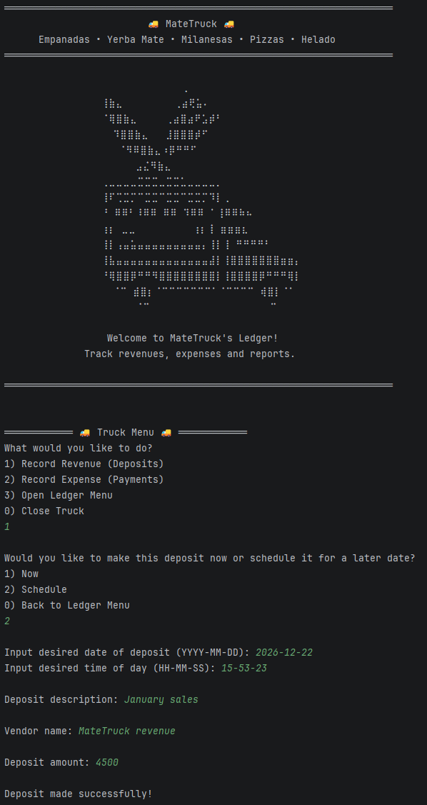
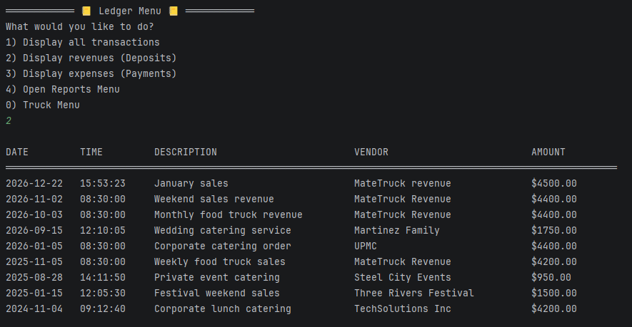
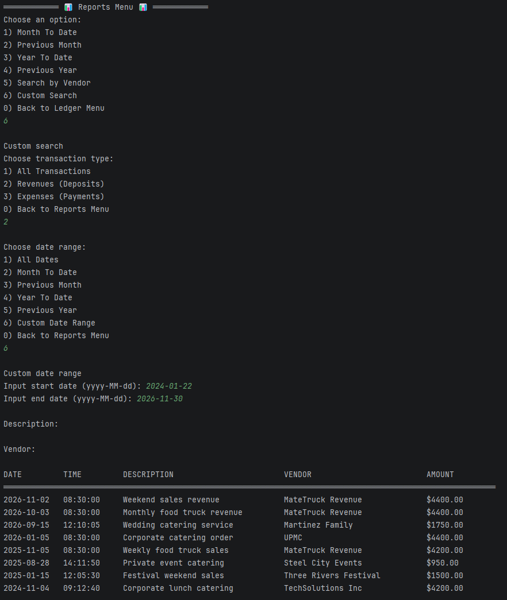

# MateTruck Ledger App


## Description of the Project

This is a basic food truck-themed ledger app that loads transaction info from a .csv file and displays it, 
with the user being able to filer it based on multiple parameters. As well as adding new transactions into said file,
either instantly or at a scheduled time.

## Features

- Loads and stores new transaction data into .csv files.
- Ability to add two types of transactions, either instantly or at a schedule time.
- Sorts and displays transaction data based on a number of choosable filters.

## User Stories

- As a food truck owner, I want to record revenue and expenses so that I can keep track of the truck's financial activity and monitor profitability.
- As a food truck owner, I want to view and filter my transaction history so that I can quickly find sales, expenses, or specific business activities.
- As a food truck owner, I want to generate date-based financial reports so that I can analyze the truck's performance over time.
## Setup

### Prerequisites

- Java 17 (Amazon Corretto), the version used in class.
- IntelliJ IDEA Community Edition: <https://www.jetbrains.com/idea/download/>

### Running the application

1. Clone this repository, or download it as a zip and unzip it.
2. In IntelliJ: File > Open, pick the project folder (the one that holds `pom.xml`), press Open.
3. Wait for IntelliJ to finish indexing (progress bar at the bottom).
4. Open `src/main/java/com/pluralsight/YourMainClassName.java`. <!-- replace YourMainClassName with the class that has main -->
5. Right-click inside the file and choose Run 'YourMainClassName.main()'.

### Data and configuration

- `transactions.csv` sits at the project root, next to `pom.xml`. Contains prewritten transaction data. The program reads it at start.

## Technologies Used

- Java 17
- IntelliJ IDEA

## Demo







## A piece of code I am proud of

```java
        // Snippet from displayLedger()
        List<Transaction> filteredLedger = new ArrayList<>(ledger);
        
        if (transactionFilter != null){
            filteredLedger = filterByTransaction(filteredLedger, transactionFilter);
        }
        
        if (dateFilter != null){
            filteredLedger = filterTransactionsByDate(filteredLedger, dateFilter);
        }
        
        if (descriptionFilter != null){
            filteredLedger = filterTransactionsByDescription(filteredLedger, descriptionFilter);
        }
        
        if (vendorFilter != null){
            filteredLedger = filterTransactionsByVendor(filteredLedger, vendorFilter, scanner);
        }
        
        if (filteredLedger.isEmpty()) {
            System.out.println("\nNo matching transactions found.");
            return;
        }
        
        filteredLedger.sort(
                Comparator.comparing((Transaction transaction) ->
                                LocalDateTime.parse(
                                        transaction.getDate() + " " + transaction.getTime(),
                                        DATETIME_FMT))
                        .reversed()
        );
```
This piece of code creates a copy of the ledger arraylist, and applies all selected filters to it. 
If by the end of it there are no matching transactions left in the array, a message is printed, and it returns the user to the previous menu.
If there are still matching transactions left, it sorts them by date from earliest to oldest. And leaves an array that is ready to be printed out.
I am particularly proud of this section because it allows multiple filters to be combined dynamically. 
Each filter builds on the results of the previous one, allowing users to search transactions by multiple parameters without duplicating code. 
This made the search functionality easy to maintain and extend as new filter types were added.

## Future Work

- Separate  future transaction scheduling and past transaction logging into two different features.
- Ability to delete transactions.
- Ability to modify transactions.

## Resources


- Java YearUp Fall 2026 hub: <https://raymaroun.github.io/yearup-java-fall2026/>

## Author


- **Fabricio Leonel Baliño @ https://github.com/FabricioB44**

## Thanks

- Thank you to Raymond Maroun for guiding me with Java and pushing me to better document my code!